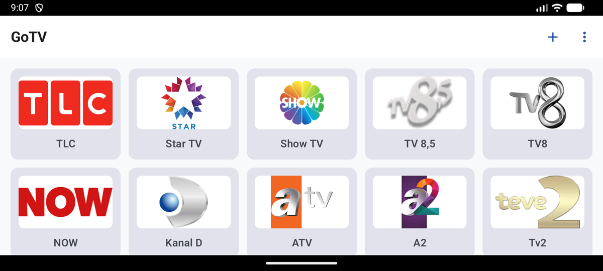
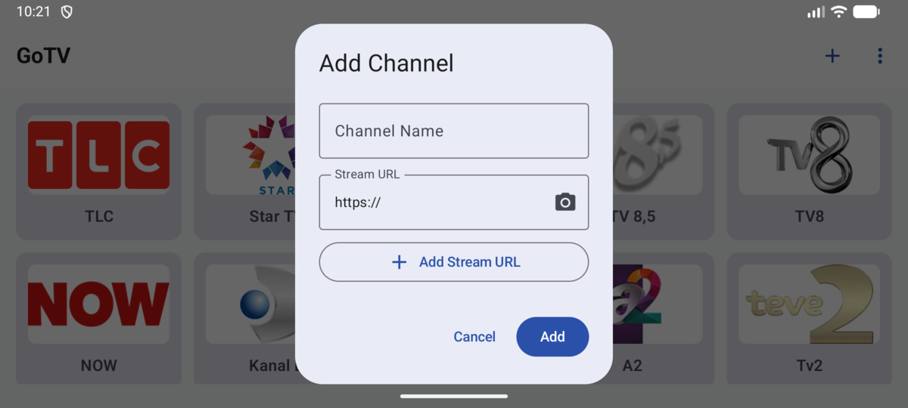
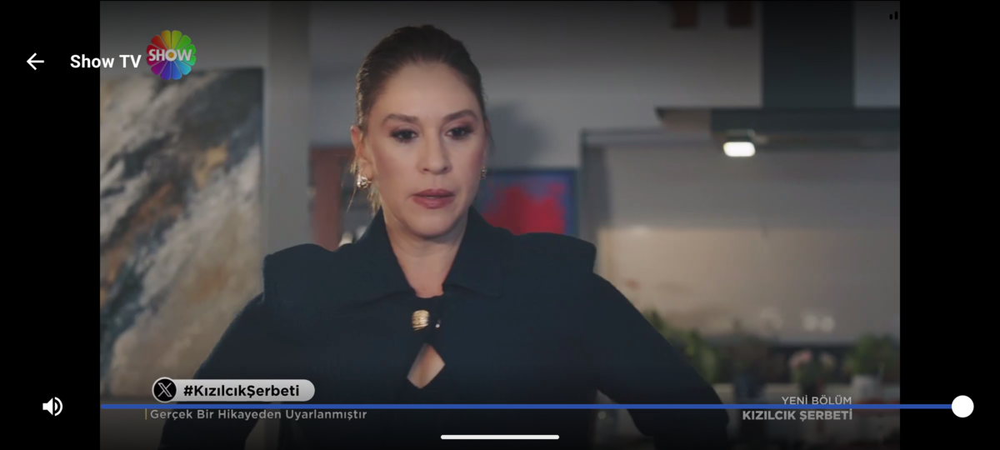
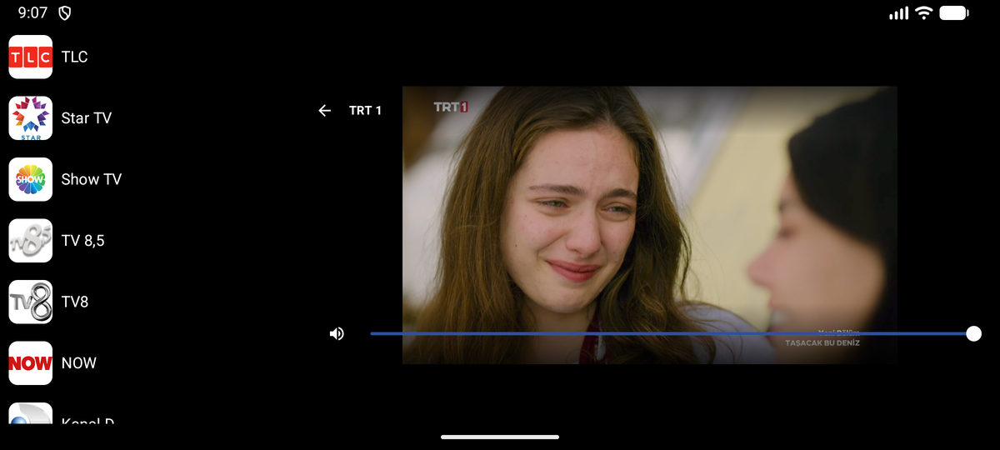

# GoTV

A lightweight, low-RAM Android IPTV player designed for smooth live stream playback on low-spec hardware and Android Go devices.

## User Guide & Walkthrough

Learn how to use GoTV to organize channels, import playlists, and enjoy seamless live playback.

### 1. Channel Dashboard

  

* **Browse Channels:** Scroll through your custom channels presented in a clean, responsive grid layout. All channel logos are downsampled and cached on disk to maintain a low RAM footprint on 1 GB–2 GB devices.
* **Reorder Channels:** Long-press and drag any channel tile to rearrange your channel lineup to your preference.
* **Quick Channel Launch:** Tap any channel card to immediately start full-screen live playback.

---

### 2. Adding & Importing Channels

  

* **Manual Addition:** Tap the **+** (Add Channel) icon on the top app bar. Enter the channel name, HLS stream URL (`.m3u8`), and optional logo URL.
* **QR Code Scanner:** Instead of typing long URLs with an on-screen keyboard or remote, tap the QR icon next to the URL input fields to scan a QR code using your device camera or pick a QR image from your gallery.
* **Batch Import & Export:** Tap the overflow menu (`⋮`) on the dashboard to:
  * **Import from URL:** Download remote channel lists directly.
  * **Import / Export Backup:** Save your channel setup to a JSON file or restore it onto another device.

---

### 3. Focused Fullscreen Live Playback

  

* **Lean Live Streaming:** Clean playback powered by AndroidX Media3 (ExoPlayer), tuned specifically for live HLS streams without scrubbing bars, DVR buffering, or playback control clutter.
* **Volume Controls:** Adjust audio output using physical volume keys, on-screen volume slider, or vertical swipe gestures on the video viewport.
* **Network Resilience:** Automatically displays a non-blocking loading indicator and reconnects smoothly when network connectivity drops.

---

### 4. Quick In-Player Channel Switching

  

* **Open Channel Sidebar:** Tap anywhere on the video during playback. The active video smoothly shrinks to the side and the channel list slides in.
* **Switch Without Leaving:** Tap any channel in the sidebar to switch instantly without exiting to the main dashboard.
* **Auto-Dismissing Drawer:** The sidebar automatically hides after 10 seconds of inactivity or when tapping on the video area.

---

## Features

- **Low RAM Footprint**: Minimal heap allocation, constrained buffer pipelines, and aggressive memory management designed for 1 GB–2 GB RAM devices.
- **Channel Dashboard**: Clean grid layout displaying channels with locally cached, downsampled logos.
- **Easy Channel Import**: Add channels manually (name, M3U8 stream URL, optional logo URL) or scan QR codes via camera / gallery image.
- **Focused Live Playback**: Distraction-free full-screen live streaming using AndroidX Media3 (ExoPlayer) without seek bars, DVR buffering, or unnecessary scrubbing controls.
- **Quick In-Player Channel Switching**: Tap the screen during playback to shrink the video viewport and browse channels via a 10-second auto-dismissing sidebar.
- **Stream Resilience**: Graceful error handling with an automatic loading spinner and instant reconnection when network connectivity drops.
- **Local Persistence**: Channels and downsampled logos persist across app launches.

## Tech Stack & Architecture

- **UI**: Modern Android Jetpack Compose with Unidirectional Data Flow (UDF)
- **Asynchronous State**: Kotlin Coroutines & Flow
- **Media Engine**: AndroidX Media3 (ExoPlayer) configured with a lean HLS/M3U8 source pipeline
- **QR Code Scanning**: CameraX & ML Kit Barcode Scanning
- **Storage**: Local persistence for channel metadata and disk-cached logo assets

## Documentation

- [Architecture Specification](docs/architechture-spec.md)
- [Agent Specifications & Issue Breakdown](.scratch/iptv-player/)
- [Contributing & Commit Conventions](CONTRIBUTING.md)

## Contributing & Development

All code contributions, whether from human developers or AI agents, must adhere to:
- **[Conventional Commits v1.0.0](https://www.conventionalcommits.org/en/v1.0.0/)**: Structured prefixes (`feat`, `fix`, `docs`, `refactor`, `test`, `chore`, etc.).
- **Granular commits**: Small, atomic commits reflecting a single logical change rather than large batch commits.

See [CONTRIBUTING.md](CONTRIBUTING.md) for full details and scope guidelines.

## License

This project is licensed under the Apache License 2.0. See the [LICENSE](LICENSE) file for details.

